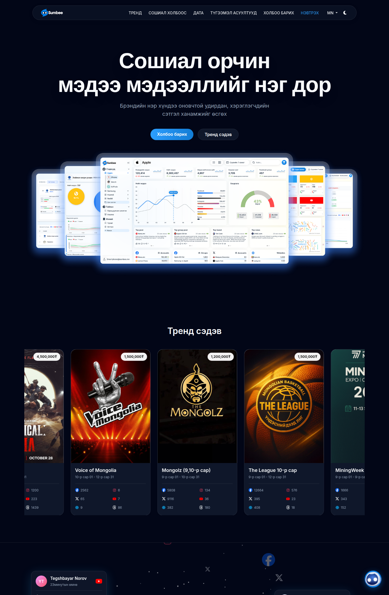
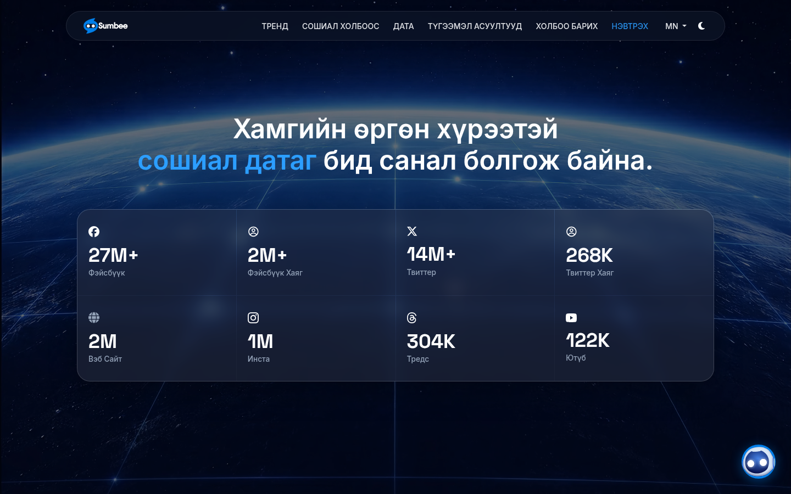
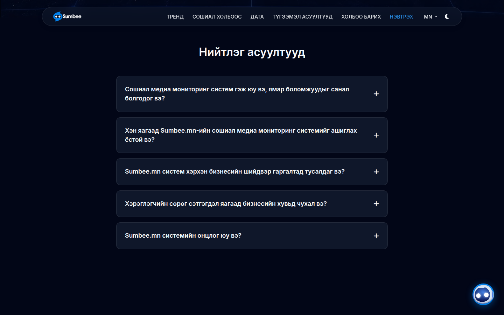
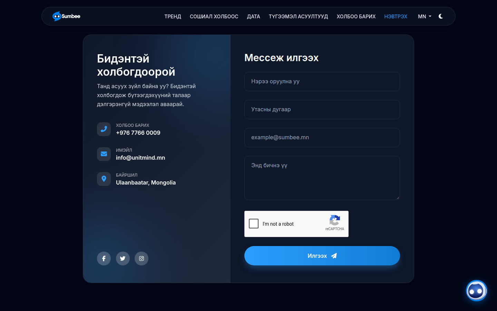
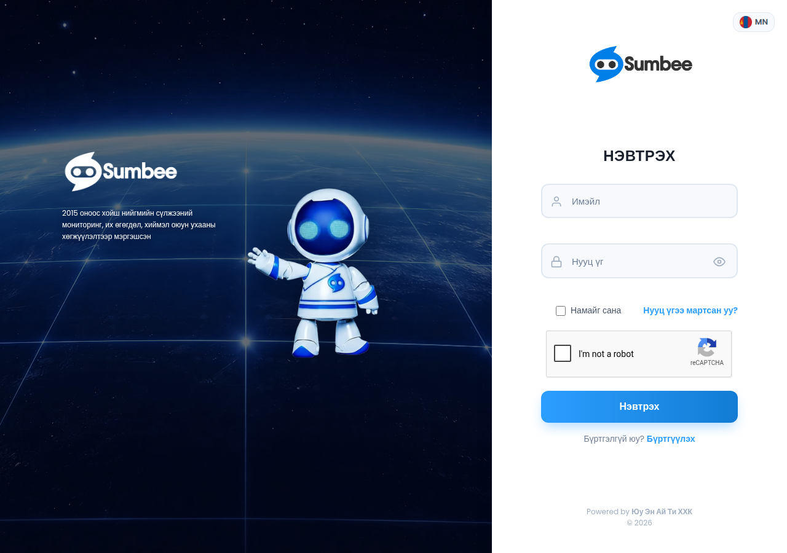
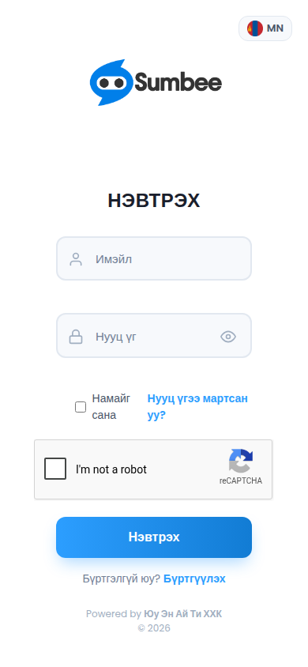
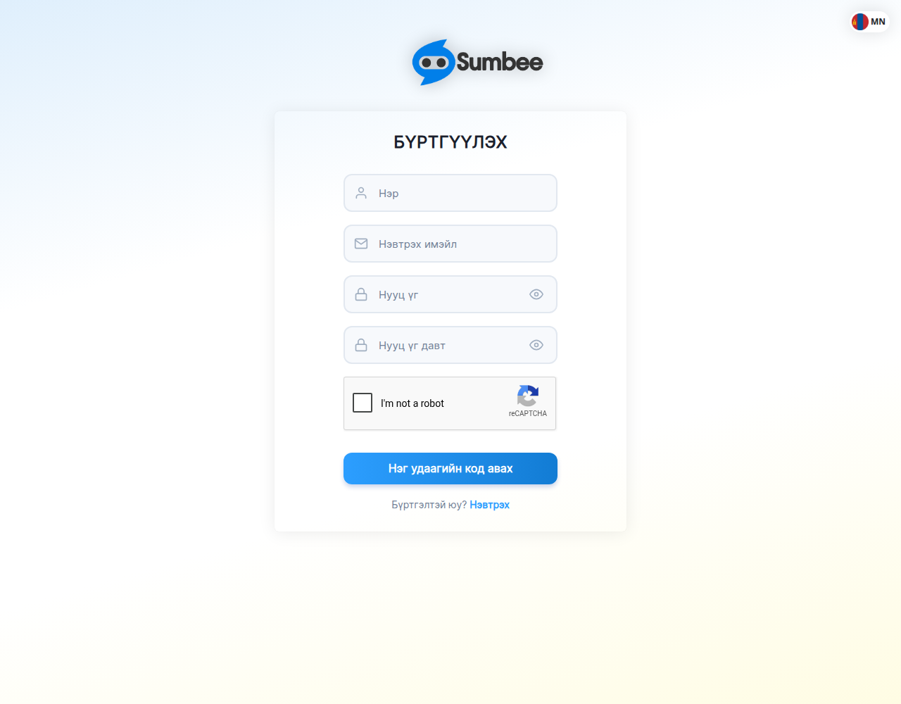
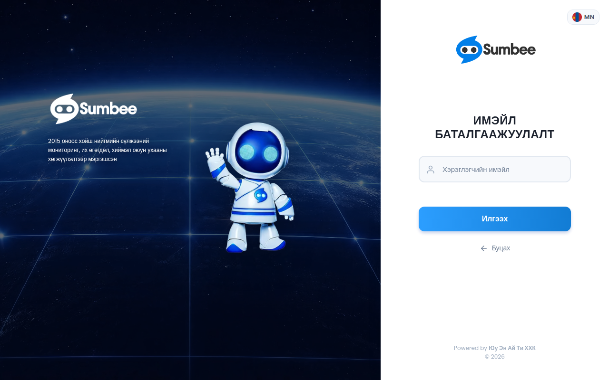

# Reverse engineering notes

Inspection date: 2026-11-09.

Sources, and only these sources:

- The public website `https://sumbee.mn/` (pages a visitor can open without an account).
- The repository at the workspace root (`nobullying84`), which is the live school reporting app for `www.safeschool84.mn`.

No login was submitted. No password was guessed. No private API was called. The chat widget was not sent a message. Contact and registration forms were not submitted. Anything behind authentication is listed under [Unknowns](#unknowns).

Screenshots of what was actually rendered are in `docs/reverse-engineering/`.

## 1. What the repository already is

The repository is not a social-intelligence product. It is a static Mongolian-language bullying-report site for a school.

| File | Role |
| --- | --- |
| `index.html` | Public report form. Writes a tracking code into Firestore `reports` and a status-only document into `publicStatus`. Notifies staff through a Google Apps Script URL. |
| `track.html` | Public status lookup by an 8-character code. Reads `publicStatus` only. |
| `success.html` | Confirmation page. Shows the tracking code from the query string. |
| `admin.html` | Teacher dashboard. Firebase Auth email/password, then an email allowlist. Lists reports, filters, updates status, exports CSV. |
| `firestore.rules` | Real access control: students may create a report, admins may read and update `status` only, deletes are denied, public status has no student fields. |
| `firebase.json` | Firebase Hosting of the repo root, plus the Firestore rules file. |
| `.firebaserc` | Default project `school-bullying-report`. |
| `notify-email.gs` | Apps Script `doPost` that sends mail to the middle-school or high-school address. |
| `CNAME` | `www.safeschool84.mn`. |

Stack that is actually in use:

- Hand-written HTML, CSS, and JavaScript. No bundler, no `package.json`, no framework.
- Firebase JS SDK 9.23.0 (compat) for App, Auth, and Firestore.
- Firebase Hosting and Firestore security rules.
- Google Apps Script for email.
- Font: Nunito. Palette: sky `#5BA4CF`, teal `#38A89D`, warm `#F7C873`, rose `#E07B7B`, background `#F0F7FF`.
- UI language: Mongolian. Three staff roles are hardcoded by email: full access, middle school (`Дунд анги`), high school (`Ахлах анги`).

Working flows observed in code:

1. A student submits the form, anonymously or by name, with level, class, bullying type, frequency, place, and description.
2. The client writes the report and a public status row, then calls the Apps Script webhook.
3. The student checks the code on `track.html` and sees a timeline.
4. A signed-in staff member sees only their level, changes status, and downloads a CSV named as Excel.

This app stores reports about minors. It stays as it is. The social-intelligence work does not read or write `reports`, `publicStatus`, or `admins`.

## 2. Sumbee public site map

Host: `https://sumbee.mn/`. Server headers: Microsoft IIS 10.0, ASP.NET MVC 5.2, ASP.NET 4.0.30319. Cookies set on the homepage: `CurrentCulture=mn` and `ASP.NET_SessionId` (HttpOnly, Secure).

`/robots.txt` and `/sitemap.xml` return the IIS 404 page.

| URL | Status | What a visitor gets |
| --- | --- | --- |
| `/` and `/?lang=mn` | 200 | Marketing page, Mongolian, dark theme by default. |
| `/?lang=en` | 200 | Same page in English. |
| `/?lang=jp` | 200 | Same page in Japanese. |
| `/Account/Login` | 200 | Sign-in. Language query `?lang=mn\|en\|jp`. |
| `/Account/Register` | 200 | Registration with email OTP. |
| `/Account/ForgotPassword` | 200 | Email confirmation form. Title still says the login title. |
| `/Account/GetSocialData` | 200 JSON | Public feed used by the homepage universe cards. See below. |
| `/Account/Ask` | not called | Homepage script posts chat messages here. Not exercised. |
| `/Home/Index` | redirect | Sends anonymous visitors to `/Account/Login?ReturnUrl=%2FHome%2FIndex`. |
| `/About`, `/Features`, `/Pricing`, `/Contact`, `/Dashboard`, `/Privacy`, `/Terms`, `/Help`, `/Blog` | 404 | IIS "file or directory not found". |
| Footer "Нууцлалын бодлого" and "Үйлчилгээний нөхцөл" | `href="#"` | No policy document is linked. |

In-page anchors on `/`: `#trends`, `#universe`, `#data`, `#faq`, `#contact`.

External profiles linked from the page: Facebook page `sumbeerobot`, Facebook messages thread, Instagram `sumbee.mn`, X `Sumbeemn`, LinkedIn company `unitllc`, `mailto:info@unitmind.mn`, `tel:+97677660009`.

## 3. Navigation and page structure

Desktop marketing nav is a fixed glass capsule (blur, 1px border, pill radius), max width about 1200px:

- Logo (image `/Content/Images/SumbeeWhiteLogo.png` on the dark header).
- Тренд → `#trends` (EN: Trend, JP: 傾向).
- Сошиал холбоос → `#universe` (EN: Social media).
- Дата → `#data` (EN: Data).
- Түгээмэл асуултууд → `#faq` (EN: FAQ).
- Холбоо барих → `#contact` (EN: Contact).
- Нэвтрэх → `/Account/Login` (EN: Sign in), accent colored.
- Language pill: MN / EN / JP.
- Theme icon (moon / sun) toggles `data-theme` on `<html>`.

At 390px the capsule links collapse. A hamburger (`#mobileMenu`) opens the same destinations, plus theme, language, and sign-in. Screenshot: `docs/reverse-engineering/home-mobile.png`.

Footer columns:

- Short product sentence about keyword monitoring and AI analysis of opinion.
- Platform: the same in-page anchors.
- Company: privacy and terms, both `href="#"`.
- Contact: `info@unitmind.mn`, `7766 0009`, Ulaanbaatar, Mongolia.
- Copyright line: Юү Эн Ай Ти ХХК, 2026.
- Language links: Mongolian, English, Japanese.

A round chat launcher sits at the bottom right (logo `/Content/assets/images/svgsLogos/Chatlogo.svg`).

## 4. Marketing sections

### Hero

- Eyebrow is absent in Mongolian. English adds the line "Social Monitoring System". English headline on the page: "Eyes Open Truth Visible". Mongolian headline: "Сошиал орчин мэдээ мэдээллийг нэг дор". Japanese headline: "目を開き、真実を見抜く".
- Mongolian subcopy: manage brand reputation and raise customer satisfaction.
- Two pills: primary "Холбоо барих" (`#contact`), ghost "Тренд сэдэв" (`#trends`).
- Behind the type is a blue spotlight (`conic-gradient`, blurred).
- The product picture is one image, `/Content/assets/images/HeroImage.png`, tilted in a perspective wrapper. It shows several floating dashboard panels (line chart, sentiment gauge, platform bars, top posts). That image is marketing art. The panels are not a live app, and the signed-in product that might match them was not opened.

English crop: `docs/reverse-engineering/home-en.png`.

### Trend topics

A Swiper row of cards. Each card is a purchase-style tile:

- Cover photo from `/Content/Images/Profile/<id>.jpg`, with a `no-picture.jpg` fallback.
- Price in tugrik, overlaid on the image.
- Title, date range in Mongolian month names, then a 2-column stat grid.

Stat order on every card, from the markup: Facebook, Instagram, X, YouTube, web (globe), Threads.

Titles, prices, and date ranges present in the HTML on the inspection day:

| Title | Price (₮) | Range | FB | IG | X | YT | Web | Threads |
| --- | --- | --- | --- | --- | --- | --- | --- | --- |
| Mongolz (11,12-р сар) | 3,000,000 | 11-р сар 01 – 3-р сар 31 | 11627 | 406 | 19040 | 36 | 1015 | 1689 |
| Physical Asia | 4,500,000 | 10-р сар 26 – 3-р сар 31 | 40109 | 1200 | 56674 | 223 | 2257 | 1439 |
| Voice of Mongolia | 1,500,000 | 10-р сар 01 – 12-р сар 31 | 2562 | 6 | 65 | 7 | 9 | 86 |
| Mongolz (9,10-р сар) | 1,200,000 | 9-р сар 01 – 10-р сар 31 | 5808 | 134 | 9116 | 36 | 382 | 180 |
| The League 10-р сар | 1,500,000 | 9-р сар 01 – 12-р сар 31 | 12664 | 576 | 395 | 23 | 408 | 18 |
| MiningWeek & MinePro 2025 | 1,200,000 | 9-р сар 01 – 9-р сар 20 | 1666 | 7 | 343 | 3 | 152 | 0 |

Clicking a card calls `openAuthModal()`. It does not reveal the report.

### Universe / social links

`#universe` is a full-width canvas (about 700px tall) of drifting nodes. Floating cards are positioned on top. The page first paints two backup examples, then `GET /Account/GetSocialData` replaces the pool. Cards refresh on an interval (20s) and on resize. A card click opens `Permalink` in a new tab when the user is not selecting text.

The public JSON, fetched once the same way the homepage does, was `{ success: true, data: [ ...25 items ] }`. Platforms in that payload: `web` 5, `yt` 5, `tw` 5, `ig` 5, `th` 5. No Facebook rows were in this response. Fields per item: `Platform`, `User`, `UserName`, `Avatar`, `AvatarUrl`, `Content`, `TimeDisplay`, `SortDate` (ASP.NET `/Date(...)/`), `Likes`, `Comments`, `Shares`, `Permalink`, `PostImageUrl`. Like / comment / share counts are rendered only when `Platform === "fb"`. Post text and images are third-party content and are not copied into this repo.

### Data coverage

Section `#data` plays `/Content/assets/images/landingEarth2.mp4` behind a dark overlay. The headline highlights "сошиал датаг" in accent blue.

The count-up reads `data-target` and runs for 2 seconds, so a screenshot taken mid-animation is not a second dataset. Targets in the HTML:

| Label | Target | Suffix |
| --- | --- | --- |
| Фэйсбүүк | 70.3 | M+ |
| Фэйсбүүк хаяг | 2.8 | M+ |
| Твиттер | 35.9 | M+ |
| Твиттер хаяг | 705 | K |
| Вэб сайт | 2.7 | M |
| Инста | 1.2 | M |
| Тредс | 800 | K |
| Ютүб | 321 | K |

These are claims on the marketing page, not measurements from this project.

### FAQ

Five accordion rows (`.faq-item`, plus icon, `toggleFaq`). Questions:

1. What a social monitoring system is and what it offers.
2. Who should use Sumbee and why.
3. How it helps business decisions.
4. Why negative customer comments matter (the answer cites an 85% conversion figure).
5. What is distinctive: keyword collection of posts and tweets, and printing a report for a chosen date range.

The answers are their marketing copy. They are not reproduced here. The useful product facts in them: one place for posts, tweets, and comments; stance, participation, and trend tracking; influencer detection; organized-activity detection; keyword queries; date-bounded printable reports; audiences named include marketing, social, brand, customer service, product, sales, founders, political staff, and PR.

### Contact

Split card. Left: phone `+976 7766 0009`, email `info@unitmind.mn`, Ulaanbaatar, Mongolia, and Facebook, X, Instagram icons. Right: form fields name, phone, email, message, reCAPTCHA, submit "Илгээх". `POST` action is `/`. The form was not submitted. A success string "Message sent successfully!" is in the page script.

### Auth wall

Opening a trend card shows a modal, title "Хандалт хязгаарлагдсан". Body says the visitor must be signed in to finish a purchase and to see full analytics. Actions: Нэвтрэх, Бүртгүүлэх. So the public trend tiles are a catalog, and the analysis sits behind an account. The catalog's checkout and the analysis screens were not available without credentials.

### Chat

Welcome modal, then a window titled "Сүмбээ Туслах" with status "Онлайн". Quick questions cover what the system does, what social monitoring is, how it differs, and which platforms it monitors. Send is `POST /Account/Ask` with `{ sessionId, message }`. The script stores `chatbot_session_id` in `localStorage` for one day, shows a remaining-question warning, and disables input at a daily limit. This endpoint was not called.

## 5. Login, registration, password reset

Shared auth layout:

- Desktop: left half is a video (`/Content/assets/images/welcome.webm` on login, `landingEarth2.mp4` also referenced) of a blue-white robot over Earth, wordmark, and the line that the company has specialized in social monitoring, big data, and AI development since 2015. Right half is a white form. "Powered by Юү Эн Ай Ти ХХК © 2026".
- Mobile: the video pane is dropped. The form is full width. Language chip stays top right.
- Inputs are light gray pills with a leading icon. Primary button is the blue gradient, 12px radius, blue shadow.
- reCAPTCHA on login and registration.
- Anti-forgery field `__RequestVerificationToken`.

Login (`POST /Account/Login`):

- Email, password, "Намайг сана" (`RememberMe`), forgot link, submit "Нэвтрэх".
- Hidden fields also present: `deviceInfo`, `ip`, `country`, `region`, `city`, `isp`, `latitude`, `longitude`. Whether the browser fills them before submit was not tested, because the form was not submitted.
- Footer link to registration.

Registration (`POST /Account/Register`):

- Name, login email, password, confirm password.
- Button "Нэг удаагийн код авах" requests a 4-digit code. A field "Нэг удаагийн код оруулна уу" is in the form. Submit value is "Бүртгүүлэх".
- The page script contains strings for a wrong login, a successful registration, and "Ойлголоо". The OTP step was not completed.

Forgot password (`POST /Account/ForgotPassword`):

- Heading "Имэйл баталгаажуулалт", field "Хэрэглэгчийн имэйл" (`UserName`), submit "Илгээх", link back.

No signed-in screen was observed after these pages. `/Home/Index` only confirms that some authenticated area exists and that anonymous users are sent to login.

## 6. Design system (public Sumbee)

Measured from the homepage CSS and the auth pages.

**Color**

| Token | Value | Use |
| --- | --- | --- |
| `--bg-body` dark | `#020617` | Page background |
| `--bg-card` dark | `#0f172a` | Cards |
| `--bg-glass` dark | `rgba(15, 23, 42, 0.6)` | Header |
| `--text-main` dark | `#f8fafc` | Primary text |
| `--text-muted` dark | `#94a3b8` | Secondary text |
| `--accent` | `#2C9EFF` | Links, highlights |
| `--accent-btn` | `linear-gradient(90deg, #2C9EFF, #127CD4)` | Primary buttons |
| Spotlight | `rgba(56, 189, 248, 0.5)` falling to transparent | Hero glow |
| Light body | `#ffffff`, text `#0f172a`, muted `#475569` | `data-theme="light"` |
| Facebook / Instagram / YouTube / web icons | `#1877F2`, `#E4405F`, `#FF0000`, `#0ea5e9` | Trend stats |
| Auth page text | `#1A202C`, `#2D3748`, `#4A5568` | Form side |
| Auth input border | `#E2E8F0` on `#F7F9FC` | Inputs |
| Error | `#E53E3E` / `#FFF5F5` | Form errors |

**Type**

- UI: Inter 300–600.
- Headlines: Space Grotesk 500–800. Hero is `clamp(3rem, 7vw, 5rem)`, weight 700, letter-spacing `-1.5px`, line-height 1.1.
- Auth headings are uppercase, tight, about 24px, dark gray.
- Nav links: 14px, weight 500, uppercase, 25px left margin.

**Space and shape**

- Header: 10px 30px padding, `border-radius: 100px`, top offset 20px, width 90%.
- Cards: 16px radius on social cards, about 22–28px on auth cards, soft shadow.
- Buttons: pill on the hero, 12–14px radius on auth, full width in the form.
- Trend stat grid: 2 columns, 8px by 15px gap, 12px type.
- Section padding around 80–100px vertically.
- Breakpoints in the stylesheet: 480px, 576px, 768px, 992px.

**Components**

- Glass capsule nav, mobile drawer, language menu, theme toggle.
- Gradient primary button and dark ghost button.
- Trend card (image, price chip, 6 platform counts) inside Swiper.
- Auth-required modal with lock icon.
- Count-up stat tiles over full-bleed video.
- FAQ accordion.
- Split contact card and floating-label inputs.
- Chat launcher, welcome modal, message list, quick replies.
- Auth split screen (media + form), show/hide password, reCAPTCHA, remember-me.
- Toastr is loaded. No toast was triggered.

**Motion**

- Theme colors transition in 0.3s.
- Social cards fade in. Universe canvas is a continuous `requestAnimationFrame` loop.
- Count-up runs 2s at a 20ms step.
- Buttons lift 2px on hover.

**Libraries on the public page**

Bootstrap 5.3.2, jQuery 3.6.0, a Font Awesome kit, Swiper 11, Toastr, Google reCAPTCHA, Google Fonts. Auth pages use MVC bundles: `/Content/bootstrap`, `/bundles/jquery`, `/bundles/jqueryval`, `/bundles/bootstrap`.

## 7. Modules the public site implies

These are inferences from visible UI and FAQ wording. They are not a confirmed information architecture of the signed-in product.

| Implied module | Evidence | Not seen |
| --- | --- | --- |
| Marketing site | The page above | |
| Account | Login, register, OTP, remember me, forgot password, culture cookie | Account settings, sessions list |
| Paid trend reports | Priced cards, "finish the purchase" modal | Cart, payment, invoice |
| Social monitoring | FAQ, universe cards, hero dashboards | The actual feed UI |
| Keyword monitoring | FAQ: keywords collect posts and tweets | Query builder |
| Coverage / source catalog | Data grid: Facebook, X, Instagram, Threads, YouTube, websites | Connector settings |
| Influencers and coordinated activity | Named in the first FAQ answer | Any screen |
| Sentiment / AI | FAQ and hero gauge art; company line about AI | Model, languages, scores |
| Date-bounded printable reports | Last FAQ answer | PDF, Excel, schedule |
| Assistant | Chat widget and `/Account/Ask` | The model behind it |
| Access control | Login wall, ReturnUrl to `/Home/Index` | Roles, organizations |

The hero image suggests the signed-in UI uses a light content surface, a left brand rail, KPI tiles, a line chart, horizontal platform bars, a semicircle gauge, and lists of top posts. Treat that as a picture, not a specification.

## 8. User workflows that are public

1. **Read the product.** Land on `/`, switch MN / EN / JP, toggle theme, scroll trends, data, FAQ, contact. Works without an account.
2. **Open a trend.** Click a card. Modal demands sign-in. Choose login or register. Stop. Full analytics and payment were not reachable.
3. **Create an account.** Open `/Account/Register`, fill name, email, password, pass reCAPTCHA, request a 4-digit email code, then submit. Not completed. Validation and error text beyond the strings already in the HTML are unknown.
4. **Sign in.** Email, password, optional remember-me, reCAPTCHA, `POST /Account/Login`. Not completed. The next URL is unknown. `/Home/Index` is at least one protected route.
5. **Reset access.** `/Account/ForgotPassword` asks for the user email and posts it. The email body and the reset screen were not opened.
6. **Ask the assistant.** Open the launcher, read the welcome note (it asks for a full Cyrillic sentence), start, send a question or a quick prompt. Not completed. Daily limit behavior is only what the script describes.
7. **Contact sales.** Fill the contact form and pass reCAPTCHA. Not completed.
8. **Browse a public post from the universe.** A card can open a third-party permalink. Those destinations were not crawled.

## 9. Repository workflows (school app)

These belong to the existing product, not to Sumbee.

1. Student fills five sections and submits. Required: gender, school level, class, group, reporter role, frequency, place, description, bully description. Name is required unless "Нэрээ нууцлах" is checked.
2. Client generates an 8-character code, batches `reports/{code}` and `publicStatus/{code}`, then notifies Apps Script, then redirects to `success.html?code=`.
3. Student opens `track.html`, enters the code, and sees one of five statuses.
4. Staff opens `admin.html`, signs in with Firebase Auth, and is rejected unless the email is on the allowlist. Level-scoped users do not see the other level. Super-admin sees both tabs.
5. Staff filters by text and status, opens a row, updates status (rules allow only the `status` field), and downloads CSV.

## 10. Unknowns

- The entire signed-in Sumbee product: navigation, dashboard, monitoring, keywords, sentiment, competitors, reports, billing, and settings. `/Home/Index` redirects to login. No credentials were available, and none were guessed.
- Whether login hidden fields (IP, city, ISP, coordinates) are populated, where they are stored, and who can see them.
- Registration OTP delivery, password rules, and the success redirect.
- Forgot-password email contents and the reset form.
- Contact form delivery and any CRM behind `POST /`.
- Chatbot provider behind `/Account/Ask`, its prompt, and its retention. The script comment says the action proxies to an external URL and saves to a database. That was not verified by calling it.
- Privacy policy and terms. The footer links are `href="#"` and no text was found.
- Payment provider, currency handling beyond the printed ₮ prices, invoices, and what a purchased trend report contains.
- Official social API providers, tokens, and ingestion schedule. `GetSocialData` is a public read model for the landing animation, not a documented API.
- User, organization, and role model inside Sumbee. Nothing on the public pages shows multi-tenant administration.
- Why the data-grid claims and the live `GetSocialData` sample disagree (the sample had no Facebook rows). Both are simply what the public site returned.
- Light-theme marketing layout. The toggle exists and the CSS variables are quoted above. A light screenshot was not kept.
- Japanese copy was fetched (`/?lang=jp`) but not screenshotted.
- Sumbee source code, private assets, and the hero/trend image binaries. They were not copied. Screenshots in `docs/reverse-engineering/` are browser captures of public pages for this design record.
- The school Firebase project contents (live reports). They were not read. Staff email addresses exist in `admin.html` and `firestore.rules`; they are not repeated in this document.
- Whether Apps Script deployment `NOTIFY_URL` in `index.html` is still the active deployment.
